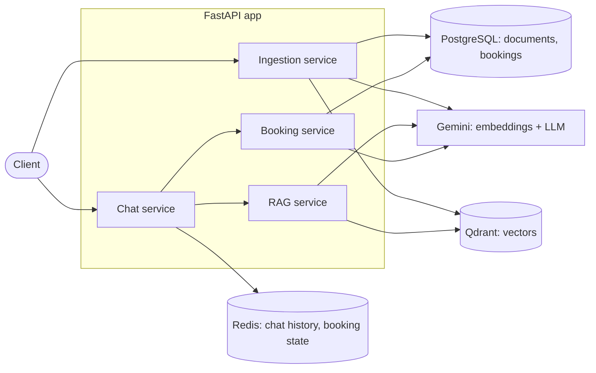
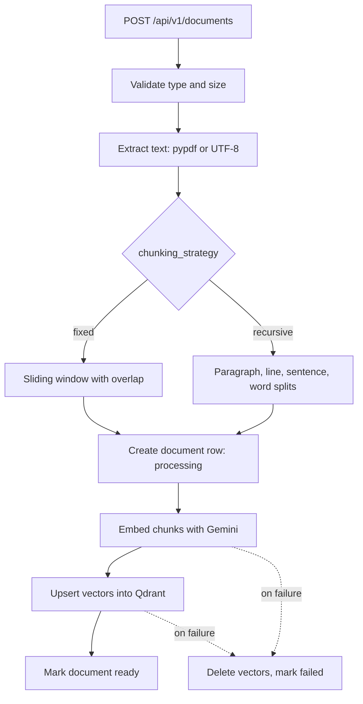
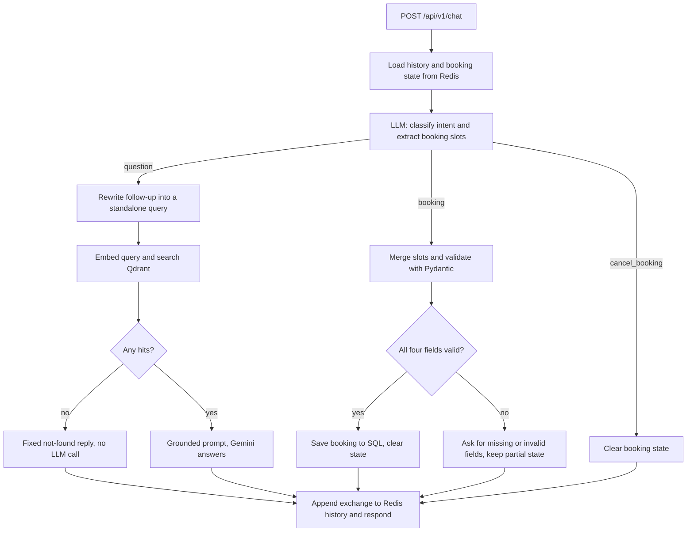

# RAG Interview API

A FastAPI backend with two REST APIs:

1. **Document Ingestion API** - upload `.pdf` / `.txt` files, extract text, split it with a selectable chunking strategy, embed the chunks with Gemini, store the vectors in Qdrant and the metadata in SQL.
2. **Conversational RAG API** - a hand-written RAG pipeline (no `RetrievalQAChain`) with Redis chat memory, multi-turn query rewriting, and LLM-driven interview booking (name, email, date, time) that is validated and stored in SQL.


## Architecture

### Components



### Ingestion flow



### Chat turn




## Project layout

```
app/
  main.py              app factory + lifespan (startup/shutdown)
  container.py         shared clients (DB, Redis, Qdrant, Gemini) built once at startup
  db.py                SQLAlchemy base, engine, sessions, table creation
  core/                config (pydantic-settings), enums, exceptions, logging
  api/                 deps.py (dependency injection) + routes/ (health, ingestion, chat)
  schemas/             Pydantic request/response models
  models/              SQLAlchemy ORM (documents, bookings)
  repositories/        database access
  services/
    chunking/          Chunker Protocol, fixed + recursive strategies, factory
    extraction.py      file validation, PDF/TXT -> text
    embeddings.py      EmbeddingClient Protocol + Gemini implementation
    llm.py             LLMClient Protocol + Gemini implementation
    vector_store.py    VectorStore Protocol + Qdrant implementation
    memory.py          Redis chat history + booking slot state
    rag.py             rewrite -> retrieve -> prompt -> generate
    booking.py         turn analysis, slot validation, persistence
    chat.py            per-turn orchestration
    ingestion.py       ingestion pipeline
tests/
```

## Running it

Requires Docker and a Gemini API key.

```bash
cp .env.example .env            # set GEMINI_API_KEY
docker compose up --build       # api + postgres + redis + qdrant
```

Interactive API docs: http://localhost:8000/docs

To run the API outside Docker (Python 3.11+):

```bash
python -m venv .venv && source .venv/bin/activate
pip install -e ".[dev]"
docker compose up -d postgres redis qdrant
uvicorn app.main:app --reload
```


### Configuration

All settings come from environment variables or `.env` (see `.env.example`). The important ones:

| Variable | Default | Purpose |
|---|---|---|
| `GEMINI_API_KEY` | required | Gemini access |
| `GEMINI_CHAT_MODEL` | `gemini-2.5-flash` | LLM for answers, rewriting, intent |
| `GEMINI_EMBEDDING_MODEL` | `gemini-embedding-001` | Embeddings |
| `EMBEDDING_DIMENSIONS` | `768` | Vector size; must match the Qdrant collection |
| `DATABASE_URL` | SQLite | Metadata and bookings |
| `REDIS_URL` | `redis://localhost:6379/0` | Chat memory |
| `QDRANT_URL` | `http://localhost:6333` | Vector store |
| `CHUNK_SIZE` / `CHUNK_OVERLAP` | `1000` / `150` | Characters per chunk / shared between neighbours |
| `RETRIEVAL_TOP_K` | `5` | Chunks retrieved per question |
| `RETRIEVAL_SCORE_THRESHOLD` | unset | Drop weak matches when set |
| `CHAT_HISTORY_MAX_MESSAGES` / `CHAT_TTL_SECONDS` | `20` / `3600` | History cap and expiry |
| `MAX_UPLOAD_MB` | `10` | Upload size limit |

## API

### `POST /api/v1/documents` - ingest a document

```bash
curl -X POST http://localhost:8000/api/v1/documents \
  -F "file=@handbook.pdf" \
  -F "chunking_strategy=recursive"      # or: fixed (default: recursive)
```

Response (`201`): `id`, `filename`, `file_type`, `chunking_strategy`, `chunk_count`, `status` (`ready`), `error`, `created_at`.

`GET /api/v1/documents/{id}` returns the stored metadata.

| Strategy | Behaviour |
|---|---|
| `fixed` | Sliding window of N characters with overlap. Predictable, ignores structure |
| `recursive` | Splits on paragraphs, then lines, sentences and words; merges pieces up to N characters with overlap. Keeps paragraphs together |

Errors use one JSON shape: `{"error": {"code": "...", "message": "..."}}`.

| Status | Code | Cause |
|---|---|---|
| 413 | `file_too_large` | Over `MAX_UPLOAD_MB` |
| 415 | `unsupported_file_type` | Not `.pdf` / `.txt`, or MIME type mismatch |
| 422 | `empty_document` / `extraction_failed` | No extractable text (for example a scanned PDF), or corrupt PDF |
| 502 | `embedding_failed` / `vector_store_failed` | Gemini or Qdrant call failed |

### `POST /api/v1/chat` - conversational RAG and booking

Send every message of a conversation with the same `session_id`.

```bash
# 1. Ask about an ingested document
curl -X POST http://localhost:8000/api/v1/chat \
  -H "Content-Type: application/json" \
  -d '{"session_id": "demo-1", "message": "What does the handbook say about remote work?"}'

# 2. Follow-up (resolved using the conversation history)
curl -X POST http://localhost:8000/api/v1/chat \
  -H "Content-Type: application/json" \
  -d '{"session_id": "demo-1", "message": "And how many days per week?"}'

# 3. Book an interview, details can arrive over several turns
curl -X POST http://localhost:8000/api/v1/chat \
  -H "Content-Type: application/json" \
  -d '{"session_id": "demo-1", "message": "I would like to book an interview. I am Anna Lee."}'

curl -X POST http://localhost:8000/api/v1/chat \
  -H "Content-Type: application/json" \
  -d '{"session_id": "demo-1", "message": "anna@example.com, next Tuesday at 2pm"}'
```

Response: `session_id`, `answer`, `intent` (`question` / `booking` / `cancel_booking`), `sources` (retrieved chunks with filename, chunk index and score), and `booking` (filled in only on the turn where a booking is saved).

How a turn works:

1. Load the chat history (`chat:{session_id}`) and any partial booking (`booking:{session_id}`) from Redis.
2. The LLM classifies the message and extracts only the booking details the user actually stated.
3. **Booking:** new values are merged into the partial booking; the code validates them (email format, real date not in the past, valid time). If all four are valid the booking is saved to SQL; otherwise the reply asks for what is missing or invalid, and the valid values are kept.
4. **Question:** the follow-up is rewritten as a standalone query, embedded, searched in Qdrant, and answered from a grounded prompt that tells the model to use only the retrieved context.
5. The exchange is appended to Redis (capped length, with a TTL).

A question asked in the middle of a booking is answered normally and does not discard the booking in progress.

## Tests and quality checks

```bash
pytest                    # 18 tests
mypy app tests            # strict typing
ruff check .              # lint
ruff format --check .     # formatting
```

| Test file | Covers |
|---|---|
| `test_chunking.py` | Both chunkers (size bounds, overlap, empty input, invalid settings) and the factory |
| `test_booking.py` | Slot validation, merging partial state, clearing invalid fields |
| `test_flows.py` | Full multi-turn booking-then-question flow, and ingestion success, rejection and failure cleanup. Uses fake Gemini/Qdrant, real SQLite and fakeredis |
| `test_api_smoke.py` | `/health` and that both APIs appear in the OpenAPI schema |
